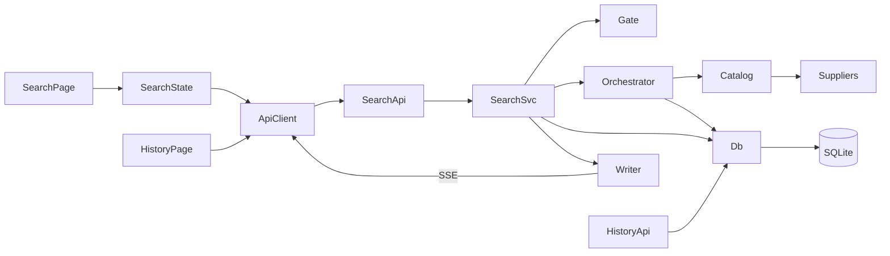

# PriceHunt

[Live demo](https://pricehunt-0zw1.onrender.com)

The live demo runs on Render Free. The first visit after idle time can be slow, and SQLite demo data can reset after a restart or redeployment.

PriceHunt compares simulated shipping quotes. A user picks an origin, a destination, a date range, and one or more suppliers. The API asks those suppliers at the same time and streams each answer to the browser as soon as it is ready. Every search and every supplier response is stored and can be filtered on the history screen.

The repository has two projects: an ASP.NET Core Web API in `server/PriceHunt.Api` and an Angular app in `client`. Suppliers are simulated inside the API. Search does not call a live shipping network.

## Overview

Live search is `/`. All seven suppliers are selected by default. After **Search prices**, each supplier appears as a pending row. Prices fill in as responses arrive, cheapest first. A progress line shows how many suppliers have responded, for example `6 of 7`. When the run finishes, a badge shows `Completed`, `Timed out`, or `Cancelled`.

The suppliers share `ISupplier` and one implementation, `SimulatedSupplier`. Profiles live in `SupplierCatalog`: SwiftShip, BudgetBox, GlobalExpress, EcoFreight, CargoPro, FlakyFreight, and SilentLine. Six answer after a random delay between 0.5 and 5 seconds. FlakyFreight fails about 30% of the time. SilentLine never answers on its own and is stopped by the 6 second deadline. The price is a simulated ILS amount: a profile base fee, a stable factor from the route name, a small date adjustment, and random jitter.

History is `/history`. Filters, sorting, and paging run on the server. Place names are free text, 2 to 80 characters. Suggestions from `GET /api/places` are optional.

## Features

- Concurrent supplier calls, with each outcome streamed as it arrives.
- A failure in one supplier stays in that supplier. The others continue.
- A 6 second deadline stops suppliers that have not answered. A normal supplier cut off this way is stored as `Timeout`. SilentLine is stored as `NoResponse`.
- Cancel from the UI, from `POST /api/search/{id}/cancel`, or by starting another search. Supplier tasks stop. A row still `Pending` shows `Cancelled` on the screen only.
- Live results stay cheapest first. Rows without a successful price stay at the bottom, and reordering is animated in place.
- History filters by date, origin, destination, and supplier, sorts every column, and pages 25 rows.

## Tech stack

| Area | Choice |
| --- | --- |
| Backend | ASP.NET Core, `net8.0` |
| Frontend | Angular 17.3, standalone components, TypeScript |
| Database | SQLite through EF Core Sqlite 8.0.8. Migration `20261031122250_InitialCreate`, applied with `MigrateAsync` |
| Streaming | Server-Sent Events, `text/event-stream` |
| Places | Optional data.gov.il autocomplete. Search does not depend on it |

There is no authentication and no Swagger UI.

## Getting started

Use two terminals. No database server and no `dotnet ef database update`. On Windows `cmd`, run each command on its own line.

Prerequisites: .NET SDK 8 or later, and Node.js 18.13+ or 20.9+.

```bash
git clone https://github.com/BatSheva00/PriceHunt.git
cd PriceHunt
dotnet run --launch-profile http --project server/PriceHunt.Api
```

The `http` profile listens on `http://localhost:5147` and does not open a browser. Wait for `Now listening on: http://localhost:5147`. Startup calls `MigrateAsync()`, which creates `server/PriceHunt.Api/pricehunt.db` on the first run. The connection string is `Data Source=pricehunt.db`. The database file is gitignored. A search left `Running` for more than a minute is marked `TimedOut` on the next startup.

In a second terminal:

```bash
cd client
npm ci
npm start
```

`npm start` runs `ng serve` on port 4200 and proxies `/api` to `http://localhost:5147`. Open `http://localhost:4200`. CORS allows that origin only.

If the locality catalog cannot be loaded, `GET /api/places` returns 503. The typed place name can still be submitted.

## Architecture



The Angular page owns the form. `SearchStateService` creates the search, reads the stream, and drops events from an older search. `ApiService` is the only HTTP client.

`SearchController` is the HTTP boundary. `SearchService` validates, stores the `SearchRun`, and owns the stream. `SearchOrchestrator` runs the suppliers, saves each outcome, then emits it. `SearchStreamGate` holds one cancel token per open stream, because cancel and the stream are different requests. `HistoryController` queries `Quotes` directly. There is no repository layer.

```text
PriceHunt/
├── server/PriceHunt.Api/
│   ├── Program.cs
│   ├── Controllers/
│   ├── Services/
│   ├── Orchestration/
│   ├── Suppliers/
│   ├── Streaming/
│   ├── Data/
│   ├── Models/
│   └── Migrations/
└── client/src/app/
    ├── core/
    ├── search/
    ├── history/
    └── shared/
```

## Search flow

1. The form checks place length, both dates, date order, and that at least one supplier is selected. Starting a search aborts the current stream and cancels that older run.
2. `POST /api/search` trims the places, resolves supplier names, ignores unknown names, and returns `201` with `searchId`, the suppliers, and `deadlineMs` of 6000. The run is stored as `Running`.
3. The client opens `GET /api/search/{id}/stream` with `fetch` and an `AbortSignal`, and shows one pending row per supplier. A missing run is `404`. A run that is not `Running`, has no suppliers, or already has a stream is `409`.
4. One task per supplier waits its random delay, or until cancellation for SilentLine, then writes `Success`, `Failed`, `Timeout`, or `NoResponse` to a channel. The reader saves the quote and emits `quote` and `progress`. Only `Success` and `Failed` increase the progress count, so a full search normally ends at `6 of 7`.
5. The client fills the matching row and keeps successful prices first. When the channel completes, the run becomes `Cancelled` if the reader was cancelled, `TimedOut` if any supplier was unanswered, otherwise `Completed`. The status is written only while the row is still `Running`.
6. `run_completed` is sent while the SSE connection is open, including after `POST /cancel`. It is not sent after the client has disconnected. History reads the saved quotes through `GET /api/history`.

## Parallel work, SSE, and cancellation

Each supplier is its own task. Tasks only write to a single-reader channel. The reader is the only code that uses the database, because `DbContext` is not thread-safe. A fault in one `GetPriceAsync` becomes `Failed` and does not stop the others. An outcome is saved before its event is sent.

I used SSE because each price has to appear before the slowest supplier finishes, and the screen still needs a completion event. One buffered HTTP response would hide the early prices. WebSockets would add a second protocol for a one-way stream. The client reads the stream with `fetch`, so `SearchStateService` passes an `AbortSignal` and consumes the body directly when the user cancels or starts a new search.

The 6 second deadline cancels the supplier token only, so timeout rows are still saved and streamed. On screen, `Success` is `Completed`, `Failed` is `Failed`, and both `Timeout` and `NoResponse` are `Timed out`. A row that has not arrived yet is `Pending`.

`POST /api/search/{id}/cancel` sets `Cancelled` only while the run is `Running`, then cancels the token in `SearchStreamGate`. Supplier tasks stop without waiting for the SSE connection to drop. Quotes already produced stay saved. A supplier cut off by cancel is stored as `Timeout`, and SilentLine as `NoResponse`. A second cancel of a finished run returns `204` and does not change the status. Disconnecting the stream also cancels the supplier tasks and does not send `run_completed`.

On the screen, cancel aborts `fetch` before `run_completed` arrives, so unfinished rows are marked `Cancelled` locally. Rows that already show a result stay. That label is display only. A new search clears the table and ignores events from the previous sequence. `SearchStreamGate` takes the same lock for cancel and dispose, so the token source is not disposed while it is being cancelled.

## Database

SQLite has two application tables. EF Core also creates `__EFMigrationsHistory`.

`SearchRuns` is one search: `Id` (GUID text), `FromLocation`, `ToLocation`, `FromDate`, `ToDate`, `SupplierNamesCsv`, `Status` (`Running` 0, `Completed` 1, `TimedOut` 2, `Cancelled` 3), `StartedAt`, `FinishedAt`, `TotalSuppliers`, and `RespondedCount` (`Success` plus `Failed`).

`Quotes` is one supplier outcome. The entity is `SupplierQuote`. Columns: `Id`, `SearchRunId` (cascade delete), `SupplierName`, `Price` (`decimal` in C#, SQLite `REAL`; non-success rows store 0), `Currency` (`ILS`), `ResponseTimeMs`, `RespondedAt`, `Status` (`Success` 0, `Failed` 1, `Timeout` 2, `NoResponse` 3), plus `FromLocation`, `ToLocation`, `SearchStartedAt`, `FromDate`, and `ToDate` copied from the run so history can filter without a join.

Indexes: status and start time on `SearchRuns`; a unique `(SearchRunId, SupplierName)` on `Quotes`; start time, supplier plus start time, and location plus start time. Location filters use `ToLower().Contains`, so that composite index is not the path for those queries.

## History

The table is one row per saved quote. Columns are Date, Route, Supplier, Price, and Response Time. The route is `from → to`. A missing price is a dash. Date filters use `SearchStartedAt`, the time the search ran, not the date range entered on the search form. `from` is inclusive. `to` includes that whole calendar day. Origin and destination are optional case-insensitive substrings. No supplier chip means all suppliers. `sortBy` allows `date`, `route`, `supplier`, `price`, and `responseTime`, default `date` descending. The client page size is 25. The API maximum is 100. Unsuccessful quotes sort after priced quotes in both directions.

## API

JSON is camelCase. Action errors use `{ "error": "..." }`.

| Method | Route | Result |
| --- | --- | --- |
| `POST` | `/api/search` | `201` with `searchId`, `suppliers`, `deadlineMs`. `400` for a bad body, place, dates, or no supplier |
| `GET` | `/api/search/{id}/stream` | SSE: `run_started`, `quote`, `progress`, `run_completed`. `404` or `409` |
| `POST` | `/api/search/{id}/cancel` | `204` if the id exists, `404` if it does not |
| `GET` | `/api/history` | `items`, `total`, `page`, `pageSize`. `400` for a bad range, sort, or page |
| `GET` | `/api/suppliers` | The seven names |
| `GET` | `/api/places?q=` | Up to eight `{ id, name }` suggestions. `503` if the catalog is unavailable |

`quote` has `supplier`, `price`, `responseTimeMs`, `status`, and `at`. `run_completed` has `status`, `responded`, `total`, and `durationMs`. History `price` is null unless the quote succeeded.

## Design decisions and trade-offs

**SSE.** I needed one-way updates on the HTTP call the dev server already proxies. The cost is a custom reader and an explicit flush so a proxy does not buffer events. I read the stream with `fetch` so the client controls the `AbortSignal` and how the body is consumed.

**SQLite.** The assignment needs a database with no separate install. One file next to the API does that. The limit is a single writer and one API process. Prices are `REAL` because SQLite has no decimal type. The C# property stays `decimal`.

**Server split.** The controller stays the HTTP boundary. `SearchService` validates and owns the stream. `SearchOrchestrator` owns concurrency, the deadline, and save-then-emit, so workers never touch `DbContext`. The cancel token sits on the singleton `SearchStreamGate` because cancel and the stream do not share a scope. The gate is in-memory and only covers one process.

**Cancellation.** `POST /cancel` and a dropped SSE connection both stop supplier tasks. The 6 second deadline stops only those tasks, so their rows are still streamed. The final status is written only while the run is `Running`, so cancel and completion cannot overwrite each other. The screen label `Cancelled` on an unfinished row is display only. The stored quote status stays `Timeout` or `NoResponse`.

## Production improvements

- **Automated tests.** Cover validation, the deadline, a failed supplier, cancellation, and history paging. This repository has no test project for that behaviour.
- **Logging and monitoring.** Add duration, supplier status, and disconnect metrics. The API uses the default ASP.NET Core log levels.
- **Scalability.** Move off one SQLite file before more than one API instance accepts searches.
- **Security.** Add authentication before exposing stored searches. This assignment has neither authentication nor authorization.
- **Resilience.** Refresh the locality catalog. A successful load currently stays until the process stops, and a failed load is not retried for 30 seconds.

## AI usage

I used Cursor while building this repository. It assisted with implementation, code review, debugging setup, checking behaviour against the assignment, and drafting this README. The behaviour described here is the behaviour in the current code.

## Verification

After both processes are running:

1. Open `http://localhost:4200`, leave all seven suppliers selected, and choose **Search prices**.
2. Rows appear as `Pending`, then fill in. The cheapest successful price moves to the top without the list jumping.
3. With SilentLine selected, the progress line stays below the supplier total, that row shows `Timed out`, and the header badge shows `Timed out`.
4. On some runs FlakyFreight shows `Failed` with no price. The other suppliers in that run still return.
5. Press **Cancel search** while rows are pending. The header shows `Cancelled`. Finished rows stay. Rows that were `Pending` show `Cancelled`. The next search does not show rows from the cancelled one.
6. Open **History**. Filter by a supplier, sort a column, and use **Next**. A reversed date range shows an error and keeps the current page.

The first successful API start creates `server/PriceHunt.Api/pricehunt.db`.
