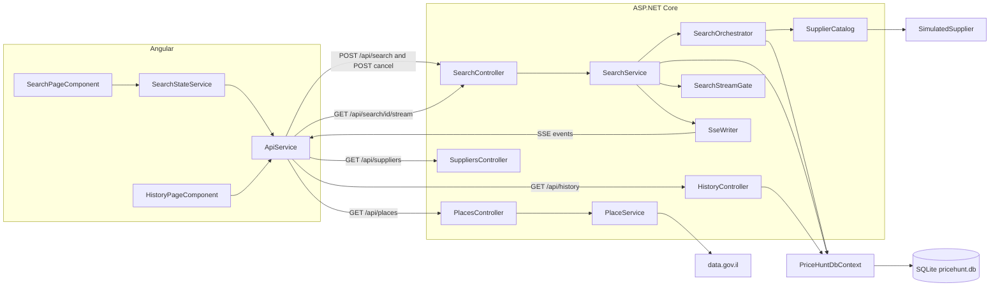
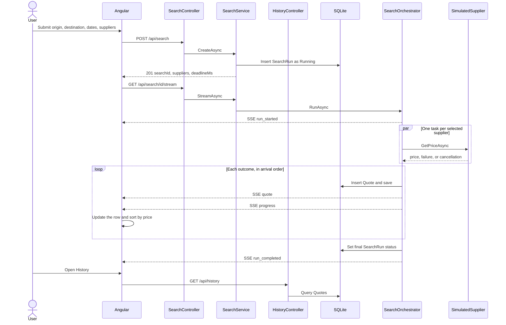
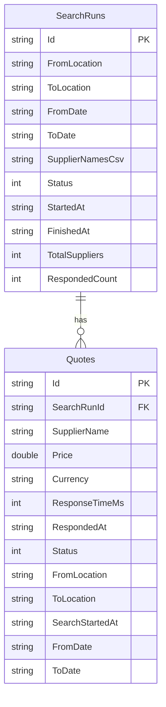

# PriceHunt

PriceHunt compares simulated shipping quotes. A user picks two places, a pickup date, a delivery date, and one or more suppliers. The server asks those suppliers at the same time and sends each answer to the browser as soon as it is ready. Every search and every supplier response is stored, and can be filtered later on the history screen.

This repository has two projects: an ASP.NET Core Web API in `server/PriceHunt.Api` and an Angular application in `client`. Suppliers are simulated inside the API. Search does not call a live shipping network.

# 1. Project Overview

A search starts on **Live search** (`/`). The form asks for an origin, a destination, a pickup date, a delivery date, and a supplier list. All seven suppliers are selected by default. After **Search prices**, each supplier appears immediately as a pending row. Prices fill in as responses arrive, and the list stays ordered from cheapest to most expensive.

The seven suppliers share one interface, `ISupplier`, and one implementation, `SimulatedSupplier`. Their delays, fees, and failure behaviour come from `SupplierCatalog`. Six of them answer after a random delay between 0.5 and 5 seconds. `FlakyFreight` rejects the request about 30% of the time. `SilentLine` never answers on its own and is stopped by the search deadline.

The browser does not wait for a single HTTP response that contains every quote. It opens a Server-Sent Events stream and updates the table from `run_started`, `quote`, `progress`, and `run_completed` events. A progress line shows how many suppliers have responded, for example `6 of 7 suppliers responded`. When the run finishes, a badge shows `Completed`, `Timed out`, or `Cancelled`.

**History** (`/history`) lists saved supplier responses. Filters, sorting, and paging run on the server.

Place suggestions are optional. The form accepts any place name from 2 to 80 characters. Suggestions, when the public catalog is reachable, come from `GET /api/places`.

# 2. Key Features

- Search quotes from the selected suppliers. The catalog names are SwiftShip, BudgetBox, GlobalExpress, EcoFreight, CargoPro, FlakyFreight, and SilentLine.
- Run those suppliers concurrently. `SearchOrchestrator.RunAsync` starts one task per supplier and reads their outcomes from a channel.
- Stream each outcome as it arrives. The client renders a row before the supplier answers, then fills in the price or the failure.
- Keep a supplier failure inside that supplier. `RunOneAsync` catches an exception from `GetPriceAsync` and records `Failed`. The other tasks continue.
- Stop a supplier that does not answer. The orchestrator cancels its linked token after 6 seconds. A normal supplier cut off by that token is stored as `Timeout`. `SilentLine` is stored as `NoResponse` because `NeverResponds` is true.
- Cancel a search from the UI, from `POST /api/search/{id}/cancel`, or by starting another search. Supplier tasks stop. A row that is still `Pending` shows `Cancelled` on the screen. Events from the abandoned search are ignored.
- Sort live results cheapest first. Rows without a successful price stay at the bottom, ordered by supplier name. Reordering is animated in place so the list does not jump.
- Persist the search and every supplier outcome, including failures, timeouts, and no-response rows.
- Browse history with date, origin, destination, and supplier filters, sort every column, and move between pages of 25 rows.

# 3. Technology Stack

| Area | Technology | Version in this repository | What it is used for |
| --- | --- | --- | --- |
| Backend | ASP.NET Core Web API | `net8.0` (`PriceHunt.Api.csproj`) | HTTP API, validation, and the SSE response |
| Frontend | Angular | 17.3 (`@angular/*` `^17.3.0`, CLI `^17.3.17`) | Standalone components, routing, and forms |
| Frontend language | TypeScript | `~5.4.2` | Client application code |
| Database | SQLite | through EF Core Sqlite `8.0.8` | A single file, `pricehunt.db`, with no database server |
| ORM | Entity Framework Core | `8.0.8` | Mapping, queries, and saving runs and quotes |
| Schema | EF Core Migrations | `20261031122250_InitialCreate` | Creates the tables on startup through `MigrateAsync` |
| Streaming | Server-Sent Events | `text/event-stream` via `SseWriter` | Sends each quote while the search is still running |
| Place suggestions | data.gov.il CKAN | resource `5c78e9fa-c2e2-4771-93ff-7f400a12f7ba` | Optional Israeli locality autocomplete. Search does not depend on it |
| Client HTTP | `HttpClient` and `fetch` | Angular 17 / browser `fetch` | JSON calls use `HttpClient`. The stream uses `fetch` so it can be aborted |

`Microsoft.EntityFrameworkCore.Design` `8.0.8` is referenced with `PrivateAssets` so the EF tools can build the project. The running API applies migrations from the compiled migration classes. It does not need the `dotnet ef` tool.

`@angular/cli` `17.3.17` declares Node.js `^18.13.0 || >=20.9.0` and npm `^6.11.0 || ^7.5.6 || >=8.0.0`. This client was built with Node.js `v24.20.0` and npm `11.19.0`. The API targets `net8.0` and was built with the .NET SDK `10.0.402`.

There is no authentication library, no message bus, and no Swagger UI in `Program.cs`.

# 4. Getting Started

Clone the repository, start the API, then start the Angular dev server. Use two terminals. No database server, manual SQL, or `dotnet ef database update` is required.

On Windows PowerShell 5.1, run each command on its own line.

## Prerequisites

- .NET SDK 8 or later, able to build a `net8.0` project. The .NET SDK `10.0.402` was used while building this repository.
- Node.js `^18.13.0` or `>=20.9.0`, and a matching npm. Node.js `v24.20.0` and npm `11.19.0` were used to build the client.
- Git.

Place autocomplete calls `https://data.gov.il/`. Search, streaming, cancellation, and history work without that call. If the catalog cannot be loaded, `GET /api/places` returns 503 and the typed place name can still be submitted.

## Clone

```bash
git clone https://github.com/BatSheva00/PriceHunt.git
cd PriceHunt
```

## Backend

From the repository root:

```bash
dotnet run --launch-profile http --project server/PriceHunt.Api
```

The `http` profile listens on `http://localhost:5147`.

Wait until the console prints that it is listening on that address. The `http` profile does not open a browser. This API does not serve Swagger. Use the Angular app below.

On startup, `Program.cs` calls `db.Database.MigrateAsync()`. That creates `server/PriceHunt.Api/pricehunt.db` the first time the API runs, and applies `20261031122250_InitialCreate` if the file is new. The connection string is `Data Source=pricehunt.db` in `appsettings.json`, relative to the API content root. `*.db` is gitignored.

The API also marks a search that is still `Running` and older than one minute as `TimedOut`, through `SearchOrchestrator.MarkOrphanedRunsAsync`. That only cleans up a run left behind by a process that stopped.

## Frontend

From `client`, in a second terminal:

```bash
cd client
npm ci
npm start
```

`package-lock.json` is in `client`, so `npm ci` is the install command. `npm start` runs `ng serve`. `angular.json` serves the app on port `4200` and proxies `/api` to `http://localhost:5147` using `proxy.conf.json`.

## Open the application

- Application: `http://localhost:4200`
- API: `http://localhost:5147`

CORS allows `http://localhost:4200` only. Use the dev server URL above. Live search is `/`. History is `/history`.

# 5. System Architecture



`SearchPageComponent` owns the form. `SearchStateService` is the live-search store: it creates the search, reads the stream, and drops events that belong to an older search. `ApiService` is the only HTTP client.

`SearchController` delegates to `ISearchService` / `SearchService`. Creating a search validates the body and inserts a `SearchRun`. Opening the stream prepares the SSE response and calls `SearchOrchestrator.RunAsync`. `SseWriter` writes one event and flushes it. `SearchStreamGate` allows one open stream per search id and holds the token that cancels it.

`SearchOrchestrator` starts the supplier tasks, persists each outcome, and emits it. `SupplierCatalog` builds seven `SimulatedSupplier` instances from profiles. `HistoryController` queries `Quotes` through `PriceHuntDbContext` directly. There is no history service and no repository layer. `PlaceService` loads and caches the locality catalog for autocomplete only.

# 6. Project Structure

```text
PriceHunt/
├── server/PriceHunt.Api/
│   ├── Program.cs
│   ├── appsettings.json
│   ├── Controllers/
│   ├── Services/
│   ├── Orchestration/
│   ├── Suppliers/
│   ├── Streaming/
│   ├── Data/
│   ├── Models/
│   ├── Dtos/
│   ├── Interfaces/
│   ├── Migrations/
│   └── Properties/launchSettings.json
└── client/
    ├── angular.json
    ├── proxy.conf.json
    ├── package.json
    └── src/app/
        ├── app.routes.ts
        ├── core/
        ├── search/
        ├── history/
        └── shared/
```

| Path | Responsibility |
| --- | --- |
| `server/PriceHunt.Api/Program.cs` | Registers services, SQLite, CORS, runs `MigrateAsync`, then maps controllers |
| `Controllers/SearchController.cs` | `POST /api/search`, the SSE stream, and cancel |
| `Controllers/HistoryController.cs` | Filtered, sorted, paged quote history |
| `Controllers/SuppliersController.cs` | The seven supplier names |
| `Controllers/PlacesController.cs` | Place suggestions |
| `Services/SearchService.cs` | Validation, the `SearchRun` insert, the stream, and the cancel status |
| `Services/SearchStreamGate.cs` | One active stream per search, and its cancel token |
| `Services/PlaceService.cs` | Cached data.gov.il locality search |
| `Orchestration/SearchOrchestrator.cs` | Parallel supplier calls, deadline, persistence, and completion |
| `Suppliers/Suppliers.cs` | `ISupplier` and `SimulatedSupplier` |
| `Suppliers/SupplierCatalog.cs` | The seven profiles and name resolution |
| `Streaming/SseWriter.cs` | `text/event-stream` framing |
| `Data/PriceHuntDbContext.cs` | `SearchRuns`, `Quotes`, keys, and indexes |
| `Models/` | `SearchRun`, `SupplierQuote`, `SearchStatus`, `QuoteStatus` |
| `Dtos/Dtos.cs` | Request, SSE, and history contracts |
| `Interfaces/` | `ISearchService` and `IPlaceService` |
| `Migrations/` | `InitialCreate` and the model snapshot |
| `client/src/app/core/` | `ApiService`, `SearchStateService`, and shared TypeScript models |
| `client/src/app/search/` | Live search form, place field, result rows, and FLIP list |
| `client/src/app/history/` | History filters, table, sort, and pager |
| `client/src/app/shared/` | Status badge labels and colours |
| `client/src/app/app.routes.ts` | `/` for live search and `/history` for history |

# 7. Search Workflow

1. The user enters an origin and a destination, pickup and delivery dates, and suppliers. The form defaults to Tel Aviv - Yafo, Haifa, tomorrow, three days ahead, and every supplier returned by `GET /api/suppliers`.
2. `SearchPageComponent.submit` checks the place length, both dates, date order, and that at least one supplier is selected. `SearchStateService.search` then increments a sequence number, aborts any current stream, and asks the API to cancel that older search.
3. `ApiService.createSearch` sends `POST /api/search`. `SearchService.CreateAsync` trims the places, requires 2 to 80 characters, requires both dates, rejects a delivery date before the pickup date, and resolves supplier names through `SupplierCatalog.Resolve`. Unknown names are ignored. If none remain, the API returns 400.
4. The service inserts a `SearchRun` with status `Running` and `StartedAt` set to UTC now, saves it, and returns `201` with `searchId`, the resolved supplier names, and `deadlineMs` of `6000`.
5. If this response still belongs to the latest sequence number, the client creates one pending row per supplier and opens `GET /api/search/{id}/stream` with `fetch` and an `AbortSignal`.
6. `SearchService.StreamAsync` loads the run, rejects a missing run with 404, and rejects a run that is not `Running`, has no suppliers, or already has a stream with 409. It registers a cancel token in `SearchStreamGate`, checks the status again, then sets the SSE headers and calls `SearchOrchestrator.RunAsync` with `HttpContext.RequestAborted` and that token.
7. The orchestrator emits `run_started`. The reader waits on a token linked to the client and to `POST /cancel`. The supplier tasks wait on a second token linked to the reader, with `CancelAfter` of 6 seconds. Those tasks share nothing except a channel. The database is used only by the reader loop, because `PriceHuntDbContext` is not thread-safe.
8. Each `SimulatedSupplier.GetPriceAsync` waits a random delay from its profile, or waits until cancellation when the profile is `SilentLine`. It may throw for `FlakyFreight`. The price is a simulated amount in ILS: a profile base fee, a stable hash treated as distance, a small date surge, and random jitter. It is not a road distance and not a live tariff.
9. `RunOneAsync` writes a `SupplierOutcome` of `Success`, `Failed`, `Timeout`, or `NoResponse`. The reader saves a `Quotes` row, then emits `quote` and `progress`. `progress.responded` counts only `Success` and `Failed`. `Timeout` and `NoResponse` do not increase it, so a full seven-supplier search normally ends at `6 of 7` because of `SilentLine`.
10. `SearchStateService.apply` updates the matching row. A price is kept only for `Success`. `sortedRows` orders successful prices ascending and places the other rows below them. `ResultsListComponent` animates the move from the previous position over 240ms.
11. When the channel completes, the orchestrator chooses `Cancelled` if the reader token was cancelled, `TimedOut` if any supplier was unanswered, and otherwise `Completed`. The final write updates a row only while it is still `Running`, so a cancel and a completion cannot overwrite each other. `run_completed` is sent when the SSE connection is still open, including after `POST /cancel`. It is not sent after the client has disconnected.
12. The history screen reads those saved quote rows through `GET /api/history`.



# 8. Parallel Execution, SSE, Timeout, and Cancellation

`RunAsync` builds one `Task` per `ISupplier` and waits for them with `Task.WhenAll` inside `CloseWhenSettledAsync`. Each task only writes to a `Channel` created with `SingleReader`. The reader persists an outcome before it emits the matching SSE event, so the browser does not see a quote that failed to save. A fault in one `GetPriceAsync` is caught in that task and becomes `Failed`. It does not cancel the sibling tasks.

SSE is used because the assignment asks for each response as it arrives, within one search, without waiting for the slowest supplier. One long HTTP response would hide early prices. WebSockets would add a second protocol for a one-way stream. `SseWriter.Prepare` sets `text/event-stream`, `no-cache`, and `X-Accel-Buffering: no`. `WriteAsync` writes the `event` and `data` lines and flushes. The Angular client does not use `EventSource`. `ApiService.stream` uses `fetch` because the stream must be aborted when the user cancels or starts a new search, and `EventSource` would reconnect on its own.

The deadline is `SearchOrchestrator.Deadline`, 6 seconds, on the supplier token only. A full seven-supplier search still ends `Timed out` at about 6 seconds, with `SilentLine` stored as `NoResponse` and the others saved. `Timeout` and `NoResponse` both show as `Timed out` on the row. A successful quote is badged `Completed`, a rejected quote `Failed`, and a row that has not arrived yet `Pending`.

`SearchService.CancelAsync` sets `Cancelled` only while the row is still `Running`, then cancels the token registered for that stream. Supplier tasks stop without waiting for the SSE connection to drop. If the connection is still open, the stream ends with `run_completed` and status `Cancelled`. Quotes already produced stay saved. A supplier cut off by that cancel is stored as `Timeout`, and `SilentLine` as `NoResponse`. If the run has already finished, the update matches no row and the tasks are left alone. The response is still 204.

`SearchStreamGate` keeps one `CancellationTokenSource` per open stream. `Cancel` and `Exit` take the same lock, and `Dispose` runs only after the registration is removed, so one cannot dispose the source while the other is cancelling it. A second stream for the same id is still rejected with 409.

`SearchStateService.cancel` aborts the fetch, sets the run badge to `Cancelled`, and then posts to `/cancel`. The abort happens before `run_completed` arrives, so the screen updates the unfinished rows itself. A row that already shows `Completed`, `Failed`, or `Timed out` stays. A row that is still `Pending` shows `Cancelled`. That label is display only. The database still stores a supplier cut off by cancel as `Timeout`, and `SilentLine` as `NoResponse`. Starting a new search clears the table, cancels the previous id, and ignores events from the old sequence. Disconnecting, without the POST, also finishes the run as `Cancelled` and does not send `run_completed`. If the stream ends without that event while the screen still says it is streaming, the client shows `The connection closed before the search finished.`

# 9. Database Design

SQLite stores two application tables. Entity Framework also creates `__EFMigrationsHistory` when `MigrateAsync` runs. The application migration does not define that table. EF Core uses it to record which migrations are already applied. The migration id in this repository is `20261031122250_InitialCreate`.

`SearchRuns` is one user search.

| Column | Meaning |
| --- | --- |
| `Id` | Primary key, GUID stored as text |
| `FromLocation`, `ToLocation` | Trimmed place names, max 120 characters |
| `FromDate`, `ToDate` | Pickup and delivery dates from the form |
| `SupplierNamesCsv` | Resolved supplier names, comma-separated, max 400 characters |
| `Status` | `Running` 0, `Completed` 1, `TimedOut` 2, `Cancelled` 3 |
| `StartedAt`, `FinishedAt` | UTC start, and UTC finish once the run closes |
| `TotalSuppliers`, `RespondedCount` | Selected count, and the count of `Success` plus `Failed` |

`Quotes` is one supplier outcome. The table name is `Quotes`. The entity is `SupplierQuote`.

| Column | Meaning |
| --- | --- |
| `Id` | Primary key, GUID stored as text |
| `SearchRunId` | Foreign key to `SearchRuns.Id`, cascade delete |
| `SupplierName` | Supplier name, max 60 characters |
| `Price` | Decimal in C#, stored as SQLite `REAL`. Non-success rows store 0 |
| `Currency` | `ILS`, max 3 characters |
| `ResponseTimeMs`, `RespondedAt` | Elapsed milliseconds and UTC timestamp |
| `Status` | `Success` 0, `Failed` 1, `Timeout` 2, `NoResponse` 3 |
| `FromLocation`, `ToLocation`, `SearchStartedAt`, `FromDate`, `ToDate` | Copied from the run so history can filter without joining `SearchRuns` |

Indexes from `InitialCreate`:

- `IX_SearchRuns_Status`
- `IX_SearchRuns_StartedAt`
- `IX_Quotes_SearchRunId_SupplierName`, unique, so a supplier is stored once per search
- `IX_Quotes_SearchStartedAt`
- `IX_Quotes_SupplierName_SearchStartedAt`
- `IX_Quotes_FromLocation_ToLocation_SearchStartedAt`

`PriceHuntDbContext` configures the same keys, lengths, cascade, unique index, and the `REAL` conversion. History location filters use `ToLower().Contains`, so that composite location index is not the access path for those contains queries.



# 10. API Endpoints

JSON uses camelCase. Errors from these actions use `{ "error": "..." }` unless model binding rejects the query before the action runs.

| Method | Route | Purpose | Request and response |
| --- | --- | --- | --- |
| `POST` | `/api/search` | Validate and store a search | Body: `fromLocation`, `toLocation`, `fromDate`, `toDate`, `suppliers`. `201` with `searchId`, `suppliers`, `deadlineMs`. `400` for a missing body, invalid place, missing or reversed dates, or no resolved supplier |
| `GET` | `/api/search/{id}/stream` | Stream that search | SSE events `run_started`, `quote`, `progress`, `run_completed`. `404` if the id does not exist. `409` if it is not running, has no suppliers, or is already streaming |
| `POST` | `/api/search/{id}/cancel` | Cancel a running search and its supplier tasks | Empty body. `204` when the id exists, including when it had already finished. `404` when it does not. A running search becomes `Cancelled`, its suppliers stop, and an open SSE stream ends with `run_completed` |
| `GET` | `/api/history` | Page of saved quotes | Query: `from`, `to`, `suppliers`, `fromLocation`, `toLocation`, `sortBy`, `sortDir`, `page`, `pageSize`. `200` with `items`, `total`, `page`, `pageSize`. `400` for a reversed date range, unknown sort, bad direction, `page` below 1, or `pageSize` outside 1–100 |
| `GET` | `/api/suppliers` | Supplier names in catalog order | No body. `200` with a string array |
| `GET` | `/api/places?q=` | Up to eight locality suggestions | `200` with `{ id, name }`. An empty `q` returns an empty array. `503` when the catalog cannot be loaded. A successful load stays in memory until the process stops. A failed load is not retried for 30 seconds |

`quote` carries `supplier`, `price`, `responseTimeMs`, `status`, and `at`. `progress` carries `responded` and `total`. `run_completed` carries `status`, `responded`, `total`, and `durationMs`. History `items` contain `id`, `date`, `route`, `supplier`, `price`, and `responseTimeMs`. `price` is null unless the quote status is `Success`.

# 11. Search History

The history screen calls `GET /api/history` and renders one table row per saved quote, not per search. Columns are Date, Route, Supplier, Price, and Response Time. The route is built in the API as `from → to` after the page is loaded. Dates are stored in UTC. The client appends `Z` when the payload has no timezone, then formats them in local time. A missing price is shown as a dash. Response time is the stored milliseconds.

The date filters compare `SearchStartedAt` with calendar days. `from` is inclusive at the start of that day. `to` is inclusive through the end of that day (`< to.Date + 1 day`). They filter when the search ran. They do not filter the pickup and delivery dates from the live-search form. Origin and destination are optional case-insensitive substrings. Leaving every supplier chip off means all suppliers. Selecting chips sends repeated `suppliers` query keys. The API also accepts a comma-separated value.

Sorting and paging happen in EF before the page is materialized. `sortBy` allows `date`, `route`, `supplier`, `price`, and `responseTime`. The default is `date` descending. The client page size is fixed at 25. The API default is 25 and the maximum is 100. Price order keeps unsuccessful quotes after priced quotes in both directions, then uses the quote id as a stable tie-break. The browser only renders the page it received. An older in-flight history response is ignored if the user has already changed the filters.

# 12. Design Decisions and Trade-offs

**SSE.** The screen has to show prices while other suppliers are still working, and it has to learn that the run ended. SSE matches that one-way flow over the HTTP call the dev server already proxies. The trade-off is a custom reader on the client and a careful flush so a proxy does not buffer the events. `EventSource` was rejected because it reconnects and cannot be aborted from `SearchStateService`.

**SQLite.** The assignment asks for a database that runs without a separate installation. A file next to the API satisfies that. The trade-off is a single writer and no multi-instance deployment. Decimal prices are stored as `REAL` because SQLite has no decimal type. The C# property stays `decimal`.

**EF Core.** It maps the two entities, applies the cascade and the unique supplier-per-search index, and runs the history query with `Skip` and `Take` in the database. History stays in `HistoryController` because a second service would only wrap one query.

**Migrations.** `MigrateAsync` creates and updates the schema on startup from `Migrations/20261031122250_InitialCreate`. A reviewer does not run SQL or the EF CLI. The design package is only there so migrations can be generated later. The trade-off is an extra compiled migration and snapshot, and a startup path that expects a database EF created. A file created outside these migrations, with no `__EFMigrationsHistory` row, is not a supported starting point.

**`ISupplier`.** All seven suppliers are the same simulation with different profiles. One class keeps the delay, failure, and price formula in one place. The trade-off is that a supplier with genuinely different behaviour would still be expressed as profile data, except `NeverResponds`, which is already a flag.

**Controller, service, and orchestrator.** The controller is the HTTP boundary. `SearchService` validates, stores the run, and owns the response stream. `SearchOrchestrator` owns concurrency, the deadline, and the order of save-then-emit. Splitting them keeps `DbContext` off the worker threads. The cancel token lives on the process-wide `SearchStreamGate`, because the cancel request and the stream request do not share a scope.

**Cancellation and failures.** `POST /cancel` and a dropped SSE connection both cancel the supplier tasks. The 6 second deadline cancels only those tasks, so their timeout rows are still streamed. Outcomes already in the channel are saved in `finally`. A supplier that never answered is not counted in the progress line, so a full search can finish at `6 of 7` together with `Timed out`. The final status is written only while the row is still `Running`.

**Denormalized quote columns.** History can filter by place and search time without joining `SearchRuns`. The copy can drift if a run were edited later. This code does not edit those fields after insert.

# 13. What I Would Improve in Production

These are follow-up steps for a deployed system. They are not missing pieces of this assignment.

- Add automated tests around validation, the deadline, a failed supplier, cancellation, and history paging. The server has no test project. The client still has the generated Angular spec and the Karma setup from the CLI, and that is not a coverage suite for this behaviour.
- Add structured logging and metrics for search duration, supplier status, and stream disconnects. The API currently uses the default ASP.NET Core log levels.
- Move off a single SQLite file if more than one API instance must accept searches. `SearchStreamGate` is an in-memory dictionary, so it only guards streams inside one process.
- Add authentication and authorization before exposing stored searches. This assignment has neither.
- Give the locality catalog its own refresh policy. A successful load currently stays in memory until the process stops, and a failed load is not retried for 30 seconds. Search would stay free text, as it is now.

# 14. AI Usage Disclosure

Cursor was used while building this repository. It assisted with implementation, code review, debugging setup, checking behaviour against the assignment, and drafting this README. The behaviour described above is the behaviour in the current code.

# 15. Verification

These are manual checks after both processes are running. This repository does not include an automated suite that performs them.

1. Open `http://localhost:4200`. Leave all seven suppliers selected and choose **Search prices**.
2. Confirm rows appear immediately as `Pending`, then change as events arrive. The cheapest successful price should move to the top without the rows jumping.
3. Wait until streaming stops. With `SilentLine` selected, expect the progress line to stay below the supplier total, that row to show `Timed out`, and the header badge to show `Timed out`.
4. Run another search. `FlakyFreight` fails on some runs and then shows `Failed` with no price. The other suppliers in that run should still return.
5. Start a search and press **Cancel search** while rows are still pending. The header badge should show `Cancelled`. Rows that already have a result stay. Rows that were still `Pending` show `Cancelled`. A following search should not receive rows from the cancelled one.
6. Open **History**. The quotes from the finished searches should be listed. Filter by a supplier, sort a column, and use **Next**. A reversed date range should show an error and keep the current page.

The API console should show `Now listening on: http://localhost:5147` before the first search. The first successful API start creates `server/PriceHunt.Api/pricehunt.db`.
